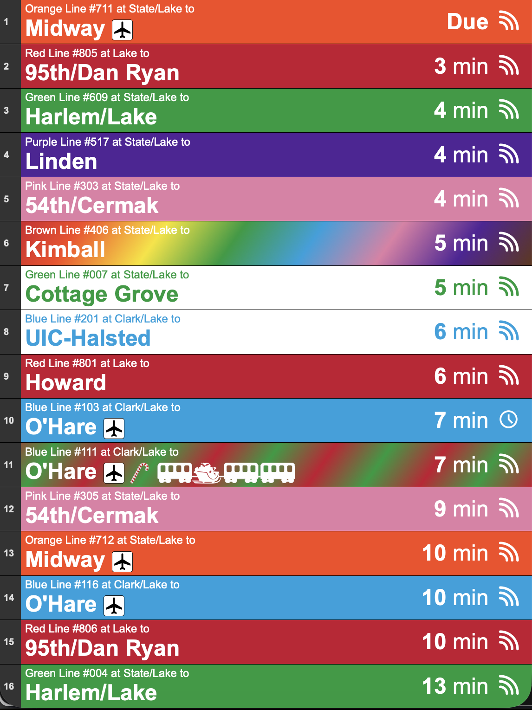

# CTA Train and Bus Arrivals Tracker

A Node.js backend that retrieves Chicago Transit Authority train and bus arrival predictions and serves them through a Fastify API. The project also renders a Handlebars view and caches API results to improve performance.

## Table of Contents

- [Features](#features)  
- [Requirements](#requirements)  
- [Installation](#installation)  
- [Running the Server](#running-the-server)  
- [Endpoints](#endpoints)  
- [Response Format](#response-format)  
- [Project Structure](#project-structure)  
- [Developer Notes](#developer-notes)

## Features

- Fastify server with static file hosting  
- Handlebars view rendering  
- CTA API batching for stop or map ID lookups  
- Combined CTA train and bus arrival estimates
- Sixty second in memory cache  
- Separate train and bus walk time filtering
- Sorted and cleaned arrival results
- Per-row refresh transitions on both display pages: retained arrivals update in place, removed rows slide upward, and new rows slide in. Reordered rows move to their new positions; reduced-motion preferences disable the animation.
- Retained rows preserve existing DOM nodes to minimize refresh flicker. The top info bar shows seconds since the last successful display refresh, following any walk-time notice with a pipe separator.

## Requirements

- Node.js 18 or newer
- CTA Train Tracker API key
- CTA Bus Tracker API key (optional; reuse the train key if it is enabled for Bus Tracker)
- A `.env` file in the project root with:

```env
TRAIN_API_KEY=your_api_key
BUS_API_KEY=your_bus_api_key
PORT=3000
```

## Installation
```
git clone <repo>
cd <project>
npm install
```

## Running the Server
```
npm start
```
Or run directly:
```
node server.js
```
The server listens on the port defined in your environment variables. The default is 3000.

## Endpoints

### GET /

Renders the main Handlebars view located at `src/pages/index.hbs`.

---

### GET /api/cta-arrivals

Fetches arrival predictions for CTA train stops and/or bus stops. Is called from the main view located at `src/pages/index.hbs`.

**Query Parameters**
Query Parameters provided to the main page at / will return a GUI, Query Parameters provided to the API will return the raw data.

| Name            | Required* | Description |
|-----------------|-----------|-------------|
| `trainStpid`    | required* | One or more CTA train stop IDs, comma separated. Use this or `trainMapid`. |
| `trainMapid`    | required* | One or more CTA train map IDs, comma separated. Use this or `trainStpid`. |
| `busStpid`      | required* | One or more CTA bus stop IDs, comma separated. Can be combined with train IDs. |
| `busRt`         | optional  | One or more bus route numbers, comma separated, to filter the requested bus stops. |
| `trainWalkTime` | optional  | Ignore train arrivals sooner than this many minutes. |
| `busWalkTime`   | optional  | Ignore bus arrivals sooner than this many minutes. |

At least one of `trainStpid`, `trainMapid`, or `busStpid` is required.

**Example Requests**

```text
/api/cta-arrivals?trainStpid=32122
/?trainMapid=40340,40360
/?trainStpid=32112&trainWalkTime=6
/?trainStpid=30162&busStpid=12345&busRt=20
```

Notes
- Requests are grouped into batches of four to limit CTA API calls.
- Bus predictions use CTA's Bus Tracker API; `BUS_API_KEY` is used when set, otherwise `TRAIN_API_KEY` is used.
- Each unique combination of IDs and walk times gets its own cache entry.
- Cache entries are valid for 60 seconds.
- The legacy train parameters `stpid`, `mapid`, and `walkTime` are still accepted.
- Train and bus requests are handled independently: one tracker can still return estimates if the other fails. Partial failures are shown on the display and logged; if all requested trackers fail, the endpoint returns HTTP 502.

## Response Format

Each arrival item returned by the `/api/cta-arrivals` endpoint includes the following fields. Bus items use `route: "Bus"`, use the bus route number for `routeNumber`, and include the stop direction in `stopDescription`. Bus minutes are calculated as `prdtm - tmstmp`, rounded down to whole minutes, using CTA timestamps in `YYYYMMDD HH:mm` (or `YYYYMMDD HH:mm:ss`) format. These minutes drive sorting and walk-time filtering; past predictions are excluded. Both display pages show `Due` for buses 0-2 minutes away and minutes for later buses. `prdctdn: "DLY"` or `dly: true` takes display priority as `Delayed`, without replacing the calculated minutes. Invalid timestamps are reported as bus-source errors.

```json
{
  "route": "Brown",
  "stationName": "Merchandise Mart",
  "stopDescription": "Platform 1",
  "arrivalTime": 4,
  "routeNumber": "423",
  "destination": "Kimball",
  "isScheduled": false,
  "isArriving": false,
  "isDelayed": false,
  "isHoliday": false,
  "isPride": false
}
```

### Field Descriptions

- **route**: Human-readable train line name, or `Bus` for a bus arrival.
- **stationName**: Name of the station or bus stop.
- **stopDescription**: Train platform or bus direction.
- **arrivalTime**: Minutes until the arrival.
- **routeNumber**: Train run number or bus vehicle ID.
- **destination**: Train or bus destination.
- **isScheduled**: Whether the train is scheduled; bus predictions are live.
- **isArriving**: Whether the vehicle is actively arriving.
- **isDelayed**: Whether the vehicle is delayed.
- **isHoliday**: Whether this is a holiday train (runs 1224 and 1225) or holiday bus (vehicle ID 4374). Both display pages use the existing holiday styling for flagged arrivals.
- **isPride**: Whether this is a pride train service.


## Project Structure

```text
/public # Static assets (CSS, JS, images)
/src/pages/index.hbs # Main Handlebars Template
server.js # Main server file
```

## Developer Notes

- **Handlebars Helper**: A `toJSON` helper is included for serializing objects inside templates.  
- **API Batching**: Requests to the CTA API are batched in groups of four to reduce load.  
- **Caching**: Arrival data is cached in memory for 60 seconds to avoid repeated API calls.  
- **Holiday Trains**: Routes 1224 and 1225 are flagged as holiday-specific trains.  
- **Data Processing**: Train and bus arrivals are filtered by their respective walk times and sorted by minutes until arrival before being returned.

## Screenshot(s)

In this screenshot, Brown Line #406 is shown as a Pride Train, and Blue Line #111 is shown as a Holiday Train